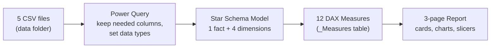
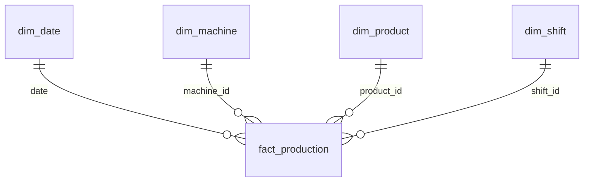

# Simple OEE Dashboard: Complete Interview Guide

This guide is for someone who knows **basic** Power BI. Every feature in the project is explained in plain language, with the exact numbers you will see on screen and the questions you are likely to get.

---

## 0. What I changed (original project vs. simple version)

| Original project | Simple version (this folder) | Why |
|---|---|---|
| Python ETL + SciPy ANOVA + Pearson correlation | **Removed** | Hard to defend if you don't know the statistics |
| IoT sensors (temperature, vibration), "Simpson's Paradox" | **Removed** | Advanced; easy to get trapped in follow-up questions |
| 6 tables (included operators) | **5 tables** (1 fact + 4 dimensions) | Smaller model, same star-schema story |
| 26 DAX measures (16 in the .pbip) | **12 measures** | You can explain every one of them |
| MTBF, Failure Count, Production Value, YTD | **Removed** | MTBF formula was questionable; "Production Value" used *unit cost*, not price |
| Hard-coded file path `C:\Users\HP\Downloads\...` | **`DataFolder` parameter** | The file opens from this folder, and the path is easy to change |
| HTML "studio", .pbit, fiscal calendar | **Removed** | Not needed |
| 3 report pages | **Same 3 pages** (small fixes) | The dashboard you show looks the same |

The original repo is untouched in `Power_BI_Project/`.

---

## 1. How to open it (5 minutes)

1. Open **`OEE_Dashboard_Simple.pbip`** (double-click it; it opens in Power BI Desktop).
2. If visuals look empty, or you get a message about data not being loaded, click **Home → Refresh**. It loads about 146k rows in a few seconds.
3. **If you get a "file not found" error** (for example, after moving the folder): **Home → Transform data → Edit parameters → DataFolder**, set it to the full path of the `data\` folder **including the last `\`**, then click Refresh.
4. Optional: **File → Save As → `.pbix`** to get a single file you can share or demo from.

> Note: Power BI Desktop has two different "Refresh" buttons. The Report view button reloads data; the Power Query editor's "Refresh Preview" only refreshes the preview.

---

## 2. The project in one picture



### 30-second pitch (memorise this)

> "I built a manufacturing OEE dashboard in Power BI on about 146,000 hourly machine records: 20 machines, 5 production lines, 3 shifts, all of 2024. I loaded the CSV files with Power Query, built a star schema with one fact table and four dimension tables, and wrote 12 DAX measures for OEE, Availability, Performance, Quality, scrap and downtime. The report has 3 pages. Overall OEE is **82.5%**, below the **85% world-class target**. The main reason is **Performance (speed)**, not breakdowns. The **night shift** and **Line E** are the weakest areas, and **equipment failure** is the biggest cause of unplanned downtime."

---

## 3. The business concept: OEE

**OEE (Overall Equipment Effectiveness)** answers one question: *of the time we planned to make products, what percentage was truly productive?*

$$\text{OEE} = \text{Availability} \times \text{Performance} \times \text{Quality}$$

| Component | Question it answers | Loss it captures | Our value |
|---|---|---|---|
| **Availability** | Was the machine running when it should be? | Breakdowns, setups, shortages | **94.4%** |
| **Performance** | When running, was it running at full speed? | Slow cycles, small stops | **90.8%** ⚠️ lowest |
| **Quality** | Were the units it made good? | Defects / scrap | **96.3%** |
| **OEE** | All three combined | | **82.5%** (target ≥ 85%) |

**Easy example:** a machine is planned for 60 minutes but runs only 54 (Availability 90%). In those 54 minutes it makes 90% of what the ideal speed allows (Performance 90%). 95% of the units are good (Quality 95%). So OEE = 0.90 × 0.90 × 0.95 = **77%**.

---

## 4. Every feature explained

### 4.1 The data: 5 CSV files in `data/`

| File | Type | Rows | One row = |
|---|---|---|---|
| `fact_production.csv` | **Fact** | 145,728 | One machine, for one hour |
| `dim_date.csv` | Dimension | 366 | One day in 2024 |
| `dim_machine.csv` | Dimension | 20 | One machine (type, line, manufacturer) |
| `dim_product.csv` | Dimension | 8 | One product (name, category) |
| `dim_shift.csv` | Dimension | 3 | One shift (Morning 6–14, Afternoon 14–22, Night 22–6) |

**Fact table** = numbers that happen (minutes, units, downtime). It has many rows.
**Dimension table** = descriptions you filter or group by (which machine, which shift, which month). It has few rows.

### 4.2 Power Query (Transform data)

Open **Home → Transform data** and click any table. The **Applied Steps** list on the right shows:

| Step | What it does | Why |
|---|---|---|
| **Source** | Reads the CSV from `DataFolder & "fact_production.csv"` | Connects to the file |
| **Promoted Headers** | Uses the first row as column names | CSVs store headers in row 1 |
| **Removed Other Columns** | Keeps only the columns I need (the fact CSV has 28 columns; I keep 12) | Smaller model, faster report, less clutter |
| **Changed Type** | Sets data types: date, whole number, decimal, text | Wrong types break sums, dates and relationships |

**`DataFolder` parameter**: one text value that holds the folder path. All 5 queries use it, so if the folder moves you change the path in **one** place.

> Interview line: "I did light cleaning in Power Query: promoted headers, removed unnecessary columns to reduce model size, set correct data types, and used a parameter for the file path so the report is portable."

### 4.3 Data model: star schema (Model view, the third icon on the left)



- **Star schema**: the fact table sits in the middle and the dimensions sit around it, like a star.
- **Relationship type: one-to-many (1 : \*)**. For example, one machine appears in many hourly rows.
- **Cross-filter direction: single** (dimension → fact). When you pick "Line_E" in a slicer, the filter flows from `dim_machine` into `fact_production`, and every measure recalculates for Line_E only.
- **Hidden key columns**: `machine_id`, `product_id`, `shift_id` and `date` are hidden in the fact table, so report builders use the dimension columns instead. This is a best practice.
- **Date table**: `dim_date` is marked as a date table, which lets time functions like `DATEADD` work. Auto date/time is turned off because we have our own date table.
- **Sort by column**:
  - `month_name` and `month_short` are sorted by `month` (1–12), so charts show Jan, Feb, Mar… and not Apr, Aug, Dec…
  - `shift_name` is sorted by `shift_id`, so shifts show as Morning, Afternoon, Night.

**Why a star schema and not one big table?** Filters are simpler and correct, the model is smaller (machine names are stored 20 times, not 145,728 times), DAX is easier, and this is Microsoft's recommended design.

### 4.4 The `_Measures` table and the 12 DAX measures

All measures live in a separate empty table called `_Measures`, grouped into 4 display folders. This keeps them in one place, easy to find.

**Measure vs. calculated column** (a very common interview question):
- A **calculated column** is computed once per row at refresh and stored, which uses memory.
- A **measure** is computed when needed, based on the current filters (slicers, chart axis). For KPIs like OEE, always use measures.

#### Folder 1: OEE

```dax
Availability = DIVIDE( SUM(fact_production[actual_run_time_min]),
                       SUM(fact_production[planned_production_time_min]) )
```
Run minutes ÷ planned minutes. **`DIVIDE`** is used instead of `/` because it returns blank instead of an error when dividing by 0.

```dax
Performance Rate = DIVIDE(
    SUMX(fact_production, fact_production[ideal_cycle_time_sec] * fact_production[total_units_produced]),
    SUM(fact_production[actual_run_time_min]) * 60 )
```
"Ideal time needed for the units we made" ÷ "time we actually ran".
- **`SUMX`** is an *iterator*. It goes **row by row**, multiplies ideal seconds × units for that row, then adds all results.
- You can't do `SUM(a) * SUM(b)` here, because that multiplies two totals and gives the wrong answer.
- `* 60` converts minutes to seconds so both sides use the same unit.

```dax
Quality Rate = DIVIDE([Good Units], [Total Units])
OEE          = [Availability] * [Performance Rate] * [Quality Rate]
```
Measures can reuse other measures. This is called **measure branching**.

> Key point: OEE is calculated as a **ratio of totals**, not an **average of row-level percentages**. Averaging percentages gives small hours the same weight as big hours, which is wrong.

#### Folder 2: Production
```dax
Total Units  = SUM(fact_production[total_units_produced])
Good Units   = SUM(fact_production[good_units])
Defect Units = SUM(fact_production[defect_units])
Scrap Rate   = DIVIDE([Defect Units], [Total Units])
```

#### Folder 3: Downtime
```dax
Downtime Hours = DIVIDE(SUM(fact_production[downtime_min]), 60)

Unplanned Downtime =
CALCULATE(
    [Downtime Hours],
    KEEPFILTERS(NOT(fact_production[downtime_reason] IN {"Planned Maintenance", "No Downtime"}))
)

Downtime % = DIVIDE(SUM(fact_production[downtime_min]), SUM(fact_production[planned_production_time_min]))
```
- **`CALCULATE`** is the most important DAX function. It **calculates a measure with changed filters**. Here it means: "downtime hours, but excluding planned maintenance".
- **`KEEPFILTERS`** means "add my filter on top of the existing filter instead of replacing it". This matters in the *Downtime by Reason* chart: without it, every bar would show the same total.
- Planned maintenance is excluded because it's **scheduled**. Management can only act on **unplanned** stops.

#### Folder 4: Time Intelligence
```dax
OEE Previous Month = CALCULATE([OEE], DATEADD(dim_date[date], -1, MONTH))
```
**`DATEADD`** shifts the dates back one month, so for March it calculates February's OEE. It's shown as a second line on the monthly trend chart. It needs a proper date table (we have `dim_date`). January is blank because there is no December 2023 data.

### 4.5 The report: 3 pages

**Common features on every page:**
- **Cards**: 4 big KPI numbers at the top.
- **Slicers**: on-page filters (Production Line, Shift, or Product Category).
- **Cross-filtering**: click a bar in any chart and the other visuals on the page filter to it. Click it again to clear.
- **Custom theme** (dark JSON theme) for consistent colours.
- **Tooltips**: hover over any bar or point to see its value.

#### Page 1: OEE Overview. *"How efficient are we, and where are we weak?"*
| Visual | Fields | What to say |
|---|---|---|
| 4 Cards | OEE, Availability, Performance Rate, Quality Rate | "OEE is 82.5%. Availability is good; Performance is the weakest part." |
| Line chart | Month × OEE and OEE Previous Month | "OEE is low in Jan–Feb (68%), peaks in Apr–Jun (~88%), dips in Jul–Sep (~80%) and recovers in Oct–Dec (~89%)." |
| Column chart | Production Line × OEE | "Line B is best (85.3%), Line E is worst (78.9%)." |
| Bar chart | Machine × OEE | "The bottom machines are all on Lines E and C, e.g. Laser_Cutter_E2 at 78.3%." |
| Slicers | Production Line, Shift | "Pick Night shift and OEE drops to 78.1%." |

#### Page 2: Production & Quality. *"How much did we make, and how much was scrap?"*
| Visual | Fields | What to say |
|---|---|---|
| 4 Cards | Total Units, Good Units, Defect Units, Scrap Rate | "21.8M units made, 811K defects, 3.72% scrap." |
| Bar chart | Product × Good Units | "Output is evenly spread across the 8 products." |
| Table | Product, Category, Total, Good, Defects, Scrap % | "Scrap is about 3.7% for every product, so quality issues come from the *process*, not one product." |
| Slicers | Product Category, Shift | "Pick Night shift and scrap rises to 4.4% (vs. about 3.4% in day shifts)." |

#### Page 3: Downtime Analysis. *"Where do we lose production time?"*
| Visual | Fields | What to say |
|---|---|---|
| 4 Cards | Downtime Hours, Unplanned Downtime, Downtime %, Availability | "8,198 hours of downtime in total; 4,259 of that was unplanned." |
| Bar chart | Downtime Reason × Unplanned Downtime | "Equipment Failure is the top unplanned cause (1,613 h, about 38%), then Material Shortage, Changeover and Power Outage." |
| Column chart | Production Line × Unplanned Downtime | "Lines A and B have the most downtime hours because they run 24/7; the other lines run weekdays only." |

---

## 5. Key insights (exact numbers Power BI will show)

| Area | Finding |
|---|---|
| Overall | **OEE 82.5%** = Availability 94.4% × Performance 90.8% × Quality 96.3%. That is 2.5 points below the 85% target. |
| Biggest loss | **Performance (speed)**. Availability is already good. |
| Lines | Best **Line_B 85.3%** · Line_D 83.8% · Line_A 83.1% · Line_C 80.3% · Worst **Line_E 78.9%** (its Performance is only 86.8%) |
| Shifts | Morning **85.7%** · Afternoon **83.8%** · Night **78.1%**. Night shift is slower (Performance 86.6%) *and* has more scrap (4.4%). |
| Months | Jan–Feb ~68% → Apr–Jun ~88% → Jul–Sep ~80% → Oct–Dec ~89%. These swings are driven by Performance. |
| Production | 21,839,423 units made · 21,027,873 good · 811,550 defects · **3.72% scrap** |
| Downtime | 8,198 h in total (5.6% of planned time). Planned maintenance is 3,939 h (48%). **Unplanned is 4,259 h**. |
| Unplanned causes | Equipment Failure 1,613 h · Material Shortage 612 h · Changeover 607 h · Power Outage 589 h · Quality Issue 416 h |
| Products | All 8 products have about 82.5% OEE and 3.7% scrap. **The problem is lines and shifts, not products.** |

**Recommendations (if asked "so what?"):**
1. Focus speed improvement on **Line E and Line C** (lowest Performance).
2. Add support and supervision on the **night shift** (slowest, most scrap).
3. Use **preventive maintenance** to cut equipment failures, the #1 unplanned cause.
4. Fix **material supply planning** (shortages are the #2 cause).

---

## 6. Likely interview questions and simple answers

**Q1. Walk me through your project.** → Use the 30-second pitch in section 2.

**Q2. What is OEE?** → Availability × Performance × Quality. It measures how much of the planned production time was truly productive. 85% is world class.

**Q3. What is a star schema? Why did you use it?** → One fact table with the numbers in the centre, dimension tables with the descriptions around it, connected one-to-many. It keeps filters simple and correct, makes the model smaller and faster, and is Microsoft's recommended design.

**Q4. Fact vs. dimension table?** → A fact table has events and numbers (minutes, units) and many rows. A dimension table has descriptive attributes (machine, shift, date) and few rows.

**Q5. Measure vs. calculated column?** → A column is computed per row at refresh and stored. A measure is computed at query time and responds to filters. I used measures for all KPIs.

**Q6. SUM vs. SUMX?** → SUM adds one column. SUMX goes row by row and evaluates an expression, then sums the results. I needed SUMX for Performance because I multiply ideal cycle time × units for each row.

**Q7. What does CALCULATE do?** → It evaluates an expression with modified filters. I used it for Unplanned Downtime (to exclude planned maintenance) and for Previous Month OEE (to shift dates back one month).

**Q8. Why DIVIDE instead of "/"?** → DIVIDE safely handles divide-by-zero by returning blank instead of an error.

**Q9. Why not just average the OEE column?** → Averaging percentages gives equal weight to every row regardless of volume. Ratio-of-totals (sum ÷ sum) is mathematically correct when you roll up to a line, shift or month.

**Q10. What did you do in Power Query?** → Promoted headers, removed unneeded columns (28 down to 12 in the fact table), set data types, and created a DataFolder parameter for the file path.

**Q11. Why do you need a date table?** → Time intelligence functions like DATEADD need a continuous date table marked as a date table. It also gives month, quarter and year columns for slicing. I turned off auto date/time.

**Q12. Relationship direction: single or both?** → Single, from dimension to fact. Bi-directional can create ambiguity and slow performance, so I avoided it.

**Q13. How do slicers and cross-filtering work?** → The slicer filters a dimension column. The relationship carries the filter to the fact table. Every measure recalculates in that filter context.

**Q14. Biggest insight?** → OEE is 82.5%. The main loss is speed (Performance 90.8%), not breakdowns. The night shift and Line E are the weakest, and equipment failure is the biggest unplanned downtime cause.

**Q15. What would you add next?** → Row-level security so each line manager sees only their line, scheduled refresh in Power BI Service, drill-through from a line to a machine-detail page, and conditional formatting (green, amber, red) against the 85% target.

**Q16. Where is the data from?** → **Be honest:** "It's a realistic synthetic dataset modelled on real factory data. I generated it so I could practise end-to-end modelling." Interviewers respect honesty; getting caught bluffing is far worse.

**Q17. How big is the data? Any performance issues?** → About 146k rows, which is small for Power BI's import mode. I still reduced columns in Power Query and used a star schema for efficiency.

---

## 7. Traps: things NOT to say (from the original README)

- ❌ "Night shift OEE is 79.6%, Morning is 87.4%" (that's from the Python version). Power BI shows **78.1% / 85.7%**. Use the dashboard numbers.
- ❌ "$3.11B production value" / "$90M opportunity". These used **unit cost**, not selling price. Don't quote them.
- ❌ ANOVA, Pearson correlation, Simpson's paradox, IoT sensor thresholds, MTBF: they're not in this version. Skip them unless you can explain them.
- ❌ "26 DAX measures". It's **12** now.

---

## 8. If asked to build something live: 20-minute rebuild

1. **Get Data → Text/CSV** → load the 5 files from `data/`.
2. **Transform data** → in `fact_production`, choose columns (Home → Choose Columns) and check data types → **Close & Apply**.
3. **Model view** → drag `fact_production[machine_id]` → `dim_machine[machine_id]` (and the same for product, shift, date). Check each one is **many-to-one, single direction**.
4. Select `dim_date` → **Table tools → Mark as date table → date**. Select `month_short` → **Sort by column → month**.
5. **Home → Enter data** → name the table `_Measures` → **Load**. Create the measures with **New measure** (copy from `DAX_Measures.dax`).
6. Build the visuals: 4 **Cards** · a **Line chart** (month_short, OEE) · a **Column chart** (production_line, OEE) · 2 **Slicers** (production_line, shift_name).
7. Format: percentages as % (Measure tools → Format), add titles.

---

## 9. Tonight's study plan (about 2 hours)

| Time | Do this |
|---|---|
| 20 min | Open the .pbip, click Refresh, click through all 3 pages, try every slicer and click bars to see cross-filtering |
| 20 min | Model view: look at the relationships. Transform data: click through the Applied Steps |
| 30 min | Read every DAX measure in section 4.4 until you can explain each in one sentence |
| 20 min | Say the 30-second pitch out loud 5 times |
| 30 min | Practise Q1–Q17 out loud |

Good luck. You only need to explain **what you built and why**, and this version has nothing in it you can't explain. 💪
