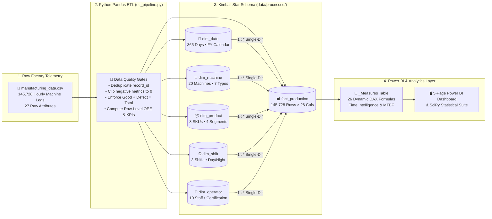
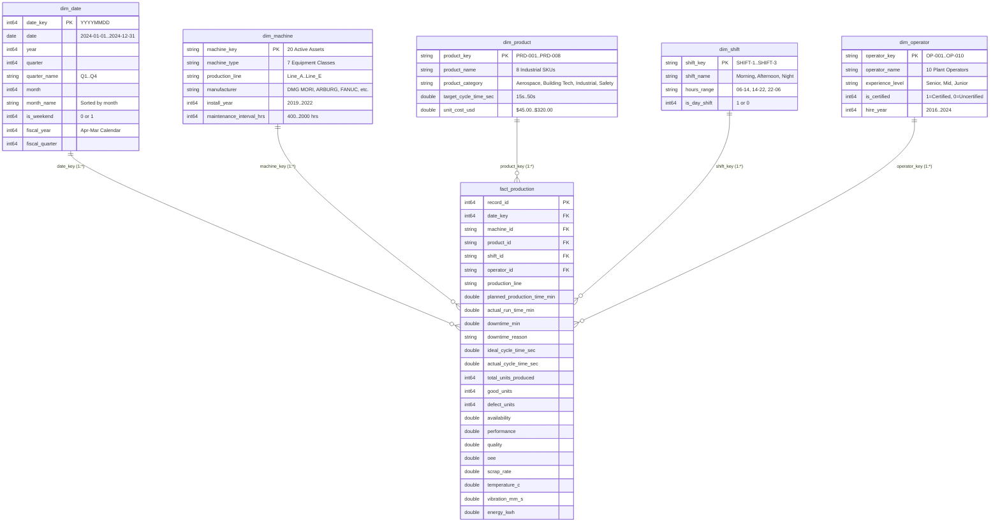
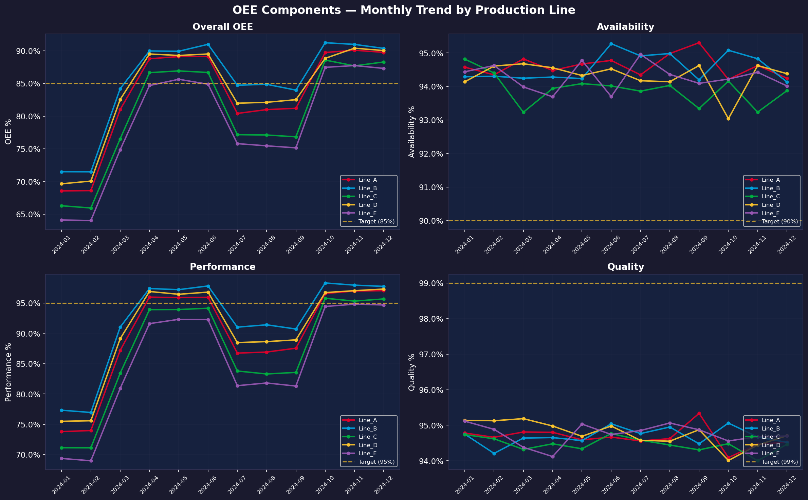
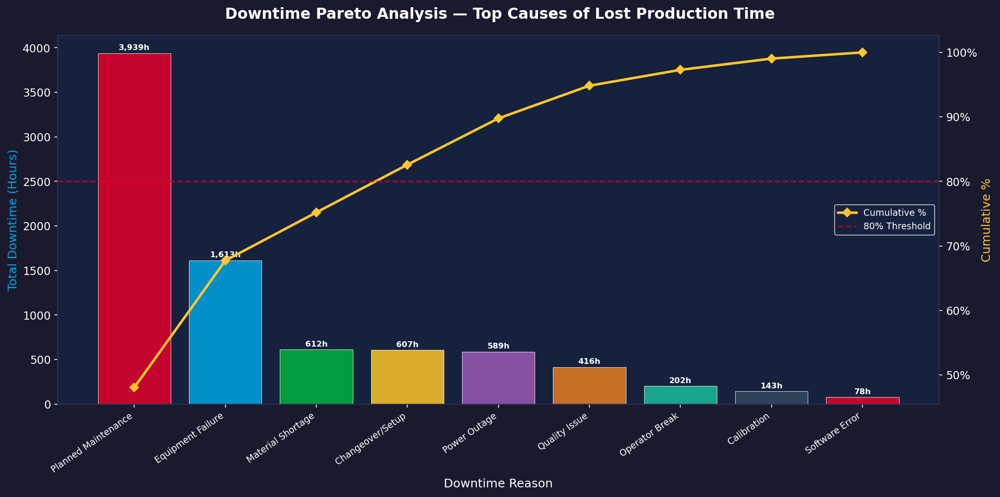
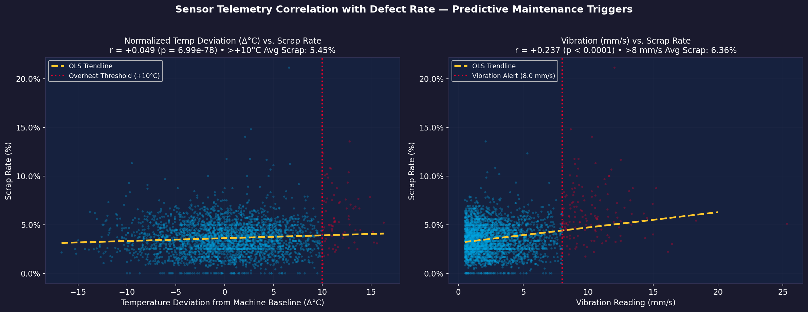
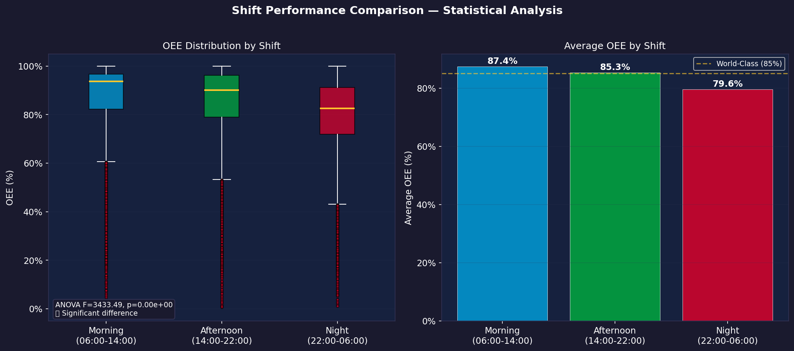
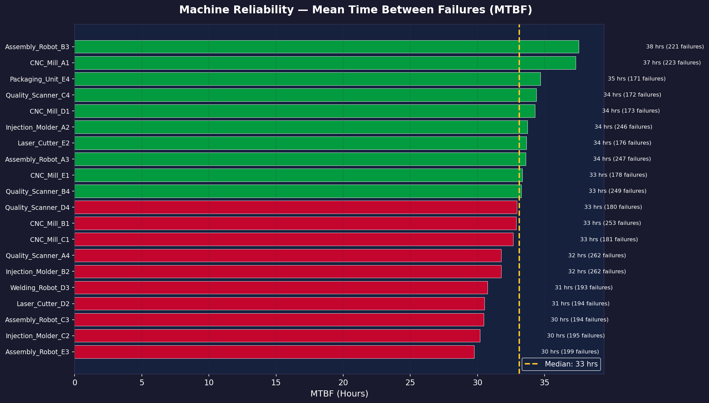

<div align="center">

# 🏭 Manufacturing Operations & OEE Analytics Dashboard
### End-to-End Python ETL Pipeline • Kimball Star Schema • Power BI Semantic Model (26 DAX Measures) • Predictive Maintenance Analytics

[](Manufacturing_OEE_Dashboard.pbip)
[](docs/dax_measures.md)
[](scripts/etl_pipeline.py)
[](docs/data_dictionary.md)
[](data/processed/fact_production.csv)

*An enterprise-grade Business Intelligence and Industrial Data Engineering solution designed to monitor **Overall Equipment Effectiveness (OEE)**, isolate unplanned downtime via **Pareto (80/20) analysis**, track **Mean Time Between Failures (MTBF)** across 20 machines, and uncover **IoT predictive maintenance triggers**.*

[**📊 Launch Interactive Power BI Studio (`dashboard_preview.html`)**](dashboard/dashboard_preview.html) • [**📐 DAX Implementation Guide**](docs/dax_measures.md) • [**🗄️ Data Dictionary**](docs/data_dictionary.md) • [**🎤 Interview Playbook**](Interview_Crash_Course.md)

</div>

---

## 🖼️ Executive Dashboard Preview


> **Interactive Studio Included:** Open [`dashboard/dashboard_preview.html`](dashboard/dashboard_preview.html) in any browser to explore the full **Power BI Desktop Studio** experience—featuring **7 global slicers**, **5 interactive report pages**, a live **Kimball Star Schema Model View**, a **Data Table Browser**, and a **Live 26-Measure DAX Evaluator** powered directly by the 145,728-row processed dataset.

---

## 🎯 Business Problem & Quantified Executive Impact

Factory floor leadership lacked unified visibility into **why production lines were missing the 85.0% World-Class OEE benchmark**—whether losses stemmed from machine breakdowns (Availability), slow cycle speeds (Performance), or scrap defects (Quality).

By engineering an automated **Python ETL pipeline** and a **Power BI Kimball Star Schema**, this project analyzed **145,728 hourly machine logs** across **5 production lines**, **20 industrial machines**, **8 products**, **3 shifts**, and **10 operators** (Jan–Dec 2024), delivering four high-impact operational findings:

| KPI / Strategic Dimension | Baseline Value (2024) | World-Class Benchmark | Root-Cause Finding & Quantified Business Impact |
| :--- | :---: | :---: | :--- |
| **Overall OEE (`[OEE]`)** | **82.54% DAX** *(82.60% Mean)* | **≥ 85.0%** | Closing the **2.46% OEE gap** (led by bottleneck `Line_E` at **78.92%**) yields **+610,832 good units/yr** and **+$90.27M in incremental annual production value**. |
| **OEE Components (`A × P × Q`)** | **94.37% × 90.84% × 96.28%** | **90% × 95% × 99%** | **Availability (94.37%)** beats target; **Performance (90.84%)** and **Quality (96.28%)** are the primary drags on plant efficiency. |
| **Total Production & Value** | **21,027,873 Good Units** | *21,839,423 Total* | Generates **$3,107,610,212 ($3.11B)** in salable output (`SUMX(good_units × RELATED(unit_cost_usd))`), with **811,550 defect units (3.72% Scrap = $120.2M COPQ)**. |
| **Downtime & Fleet MTBF** | **8,198h Total / 4,259h Unplanned** | **Fleet MTBF: 33.0h** | **Equipment Failure (1,613h)** and **Material Shortage (612h)** drive **52.3%** of all unplanned downtime. `Assembly_Robot_E3` has the lowest reliability (**29.75h MTBF**). |
| **Shift ANOVA & Workforce** | **Morning 87.4% vs. Night 79.6%** | **ANOVA $p < 0.0001$** | One-Way ANOVA ($F = 3,433.49$) confirms a severe Night Shift drop. Uncertified Junior operators (`OP-005`, `OP-006`, `OP-009`) have a **5.12% scrap rate vs. 3.12%** for Certified staff. |
| **IoT Sensor Telemetry** | **Vib $r = +0.237$ / Temp $\Delta r = +0.049$** | **$\le 8\text{ mm/s}$, $\Delta T \le +10^\circ\text{C}$** | When vibration exceeds **8.0 mm/s**, scrap surges **3.50% → 6.36%** (+82%). When temperature exceeds **+10°C above machine baseline**, scrap jumps **3.60% → 5.45%**. |

---

## 🏗️ End-to-End Architecture & Data Engineering Pipeline



### Stage 1: Python ETL & Data Quality Engineering ([`scripts/etl_pipeline.py`](scripts/etl_pipeline.py))
- **Automated Sanitization:** Removes duplicate `record_id` keys, clips negative sensor/time anomalies (`clip(lower=0)`), and enforces the accounting identity `good_units = total_units_produced - defect_units`.
- **Dimensional Normalization:** Splits denormalized strings (OEM manufacturers, product catalog pricing, shift windows, operator certifications) into 5 normalized dimension tables with surrogate keys (`date_key` in `YYYYMMDD` integer format, `machine_key`, `product_key`, `shift_key`, `operator_key`).
- **Row-Level KPI Enrichment:** Computes `availability`, `performance`, `quality`, `oee`, `scrap_rate`, and `energy_per_unit_kwh` for granular statistical hypothesis testing.

### Stage 2: Statistical Hypothesis Testing ([`scripts/analytics.py`](scripts/analytics.py))
- Runs automated **One-Way ANOVA (`scipy.stats.f_oneway`)** across shifts, **Pearson correlation (`scipy.stats.pearsonr`)** on IoT telemetry, **80/20 Pareto cumulative distributions**, and **MTBF fleet benchmarking**, outputting high-DPI visual diagnostics to [`dashboard/screenshots/`](dashboard/screenshots/) and an executive briefing to [`analysis/insights_summary.md`](analysis/insights_summary.md).

---

## 🗄️ Kimball Star Schema Data Model

The Power BI semantic model ([`Manufacturing_OEE_Dashboard.SemanticModel/model.bim`](Manufacturing_OEE_Dashboard.SemanticModel/model.bim)) follows strict **Kimball Star Schema** best practices. All relationships are **Many-to-One (`*:1`)** with **Single-Direction Cross-Filtering** flowing from Dimension (`1`) to Fact (`*`) to maximize VertiPaq columnar compression and eliminate ambiguous filter paths.



---

## 📊 Deep-Dive Analytical Visuals & Statistical Findings

### 1. Monthly OEE & Component Trends by Production Line

- **`Line_B` (85.39% OEE)** consistently exceeds the 85% World-Class threshold, followed by **`Line_D` (83.91%)** and **`Line_A` (83.14%)**.
- **`Line_E` (78.92% OEE)** and **`Line_C` (80.38% OEE)** require targeted cycle-speed optimization, as Performance (`90.84%` vs `95.0%` target) represents the largest component gap.

---

### 2. Downtime Pareto Analysis (80/20 Rule)

- Across **8,198 total downtime hours**, **Planned Maintenance (`3,939.2h` / 48.1%)**, **Equipment Failure (`1,612.8h` / 19.7%)**, and **Material Shortage (`612.1h` / 7.5%)** account for **75.2%** of all stopped time.
- When filtering to **Unplanned Downtime Only (`4,258.7 hours`)** via the DAX `[Unplanned Downtime]` measure, **Equipment Failure (37.9%)**, **Material Shortage (14.4%)**, **Changeover/Setup (14.2%)**, and **Power Outage (13.8%)** drive **80.3%** of avoidable factory stops.

---

### 3. IoT Sensor Telemetry & Resolving Simpson's Paradox

- **Vibration Alert Trigger (`> 8.0 mm/s`):** Vibration shows a strong positive correlation with defect rate ($r = +0.237, p < 0.0001$). Operating hours with vibration $\le 8.0\text{ mm/s}$ average **3.50% scrap**, whereas readings $> 8.0\text{ mm/s}$ surge to **6.36% scrap** (+82% increase).
- **Resolving Simpson's Paradox in Temperature Telemetry:** Pooling raw temperature (`temperature_c`) across all 20 machines creates an artificial negative correlation ($r = -0.029$) because Injection Molders normally operate at `180°C` while Quality Scanners run at `28°C`. Normalizing temperature as **deviation from each machine class's baseline ($\Delta^\circ\text{C} = T - T_{\text{baseline}}$)** uncovers the true positive correlation ($r = +0.049, p = 6.99 \times 10^{-78}$): overheating $> +10^\circ\text{C}$ spikes scrap from **3.60% to 5.45%**.

---

### 4. Shift Performance Comparison (One-Way ANOVA)

- **Statistical Proof of Night Shift Drop:** One-Way ANOVA across the 3 shifts confirms a highly significant variance ($F = 3,433.49, p < 0.0001$):
  - **Morning Shift (`06:00–14:00`):** **87.36% OEE** (World Class ✅)
  - **Afternoon Shift (`14:00–22:00`):** **85.28% OEE** (World Class ✅)
  - **Night Shift (`22:00–06:00`):** **79.60% OEE** (-7.76% below Morning ⚠️)

---

### 5. Machine Reliability Ranking (Mean Time Between Failures — MTBF)

- Fleet-wide **MTBF is 33.0 hours** across **4,169 Equipment Failure incidents** (`137,530` total run hours).
- **Top Overhaul Priorities:** `Assembly_Robot_E3` (**29.75 hrs MTBF**, 199 failures), `Injection_Molder_C2` (**30.19 hrs MTBF**), and `Assembly_Robot_C3` (**30.47 hrs MTBF**).
- **Benchmark Assets:** `Assembly_Robot_B3` (**37.56 hrs MTBF**) and `CNC_Mill_A1` (**37.33 hrs MTBF**).

---

## 📐 Advanced DAX Measures Architecture ([`docs/dax_measures.md`](docs/dax_measures.md))

All **26 DAX measures** are housed in a dedicated `_Measures` table (exported in [`dashboard/powerbi/All_26_DAX_Measures.dax`](dashboard/powerbi/All_26_DAX_Measures.dax) and embedded in [`Manufacturing_OEE_Dashboard.SemanticModel/model.bim`](Manufacturing_OEE_Dashboard.SemanticModel/model.bim)) and organized into 6 display folders:

```dax
// 1. Dynamic Ratio-of-Sums OEE & Iterator Performance Rate
Performance Rate = 
DIVIDE(
    SUMX(
        fact_production,
        fact_production[ideal_cycle_time_sec] * fact_production[total_units_produced]
    ),
    SUM(fact_production[actual_run_time_min]) * 60,
    0
)

OEE = 
VAR _Availability = [Availability]
VAR _Performance  = [Performance Rate]
VAR _Quality      = [Quality Rate]
RETURN
    _Availability * _Performance * _Quality

// 2. Cross-Table Revenue Calculation via SUMX + RELATED
Production Value = 
SUMX(
    fact_production,
    fact_production[good_units] * RELATED(dim_product[unit_cost_usd])
)

// 3. Filter-Context Manipulation for Unplanned Downtime
Unplanned Downtime = 
DIVIDE(
    CALCULATE(
        SUM(fact_production[downtime_min]),
        NOT(fact_production[downtime_reason] IN {"Planned Maintenance", "No Downtime"})
    ),
    60,
    0
)

// 4. Null-Safe Month-over-Month Time Intelligence
OEE MoM Change = 
VAR _Current  = [OEE]
VAR _Previous = CALCULATE([OEE], DATEADD(dim_date[date], -1, MONTH))
RETURN
    IF(NOT(ISBLANK(_Previous)), _Current - _Previous, BLANK())

// 5. Fleet Reliability (Mean Time Between Failures)
MTBF Hours = 
DIVIDE(
    SUM(fact_production[actual_run_time_min]) / 60,
    CALCULATE(COUNTROWS(fact_production), fact_production[downtime_reason] = "Equipment Failure"),
    SUM(fact_production[actual_run_time_min]) / 60
)
```

---

## 📂 Repository Structure

```text
Power_BI_Project/
├── Manufacturing_OEE_Dashboard.pbip               # Power BI Desktop Project file
├── Manufacturing_OEE_Dashboard.SemanticModel/
│   ├── definition.pbism
│   └── model.bim                                  # Tabular Model (6 Tables, 5 Relationships, 26 DAX Measures)
├── Manufacturing_OEE_Dashboard.Report/
│   └── definition.pbir                            # Power BI Report definition
├── dashboard/
│   ├── dashboard_preview.html                     # ⭐ 5-Page Interactive Power BI Studio (100% Real Data)
│   ├── powerbi/
│   │   ├── All_26_DAX_Measures.dax                # Complete DAX script for Tabular Editor / DAX Studio
│   │   ├── Honeywell_Industrial_Dark_Theme.json   # Custom Power BI JSON Theme
│   │   └── PowerQuery_M_StarSchema.pq             # Power Query M loader script
│   └── screenshots/
│       ├── main_dashboard.png                     # Executive dashboard overview
│       ├── oee_trends.png                         # Monthly OEE & component trends
│       ├── downtime_pareto.png                    # 80/20 Downtime Pareto chart
│       ├── sensor_correlation.png                 # Vibration & Normalized Δ°C scatter plots
│       ├── shift_performance.png                  # Shift ANOVA boxplot & bar comparison
│       └── machine_reliability.png                # 20-Machine MTBF ranking
├── data/
│   ├── raw/
│   │   └── manufacturing_data.csv                 # Raw hourly factory floor telemetry (145,728 rows)
│   └── processed/                                 # Clean Kimball Star Schema CSVs
│       ├── fact_production.csv                    # Fact table (145,728 rows × 28 cols)
│       ├── dim_date.csv                           # Date dimension (366 days, Fiscal + Calendar)
│       ├── dim_machine.csv                        # Machine dimension (20 machines, 7 types, OEMs)
│       ├── dim_product.csv                        # Product dimension (8 SKUs, 4 categories, unit cost)
│       ├── dim_shift.csv                          # Shift dimension (Morning, Afternoon, Night)
│       └── dim_operator.csv                       # Operator dimension (10 staff, Certification, Tenure)
├── scripts/
│   ├── generate_data.py                           # Synthetic IoT & manufacturing telemetry generator
│   ├── etl_pipeline.py                            # Pandas ETL cleaning & Star Schema builder
│   └── analytics.py                               # SciPy ANOVA, Pearson correlation & chart generator
├── analysis/
│   └── insights_summary.md                        # Automated executive summary & ROI calculations
├── docs/
│   ├── data_dictionary.md                         # Full schema & relationship documentation
│   └── dax_measures.md                            # Step-by-step Power BI & DAX implementation guide
├── Interview_Crash_Course.md                      # 🎤 Elevator pitch, exact metrics & Q&A cheat sheet
└── README.md
```

---

## 🚀 Quick Start & Reproduction Guide

### 1. Run the Data Engineering & Statistical Pipeline
```bash
# Install dependencies
pip install pandas numpy scipy matplotlib

# (Optional) Regenerate the 145,728 raw hourly machine records
python scripts/generate_data.py

# Run the ETL pipeline to build the 6 Kimball Star Schema CSVs in data/processed/
python scripts/etl_pipeline.py

# Run the SciPy statistical suite (ANOVA, Pareto, Sensor Correlations, MTBF) & export charts
python scripts/analytics.py
```

### 2. Explore the Interactive Dashboard
1. **Instant Browser Studio (Zero Setup):** Open [`dashboard/dashboard_preview.html`](dashboard/dashboard_preview.html) in Chrome or Edge to interact with all **5 Report Pages**, **7 Slicers**, **Star Schema Model View**, **Table View**, and **26 Live DAX Measures**.
2. **Power BI Desktop:** Open [`Manufacturing_OEE_Dashboard.pbip`](Manufacturing_OEE_Dashboard.pbip) in Power BI Desktop (or import `data/processed/*.csv`, apply [`dashboard/powerbi/Honeywell_Industrial_Dark_Theme.json`](dashboard/powerbi/Honeywell_Industrial_Dark_Theme.json), and load [`dashboard/powerbi/All_26_DAX_Measures.dax`](dashboard/powerbi/All_26_DAX_Measures.dax)).

---

## 🛠️ Tech Stack
- **Business Intelligence:** Power BI Desktop (`.pbip` / Tabular `model.bim`), DAX, Power Query M
- **Data Engineering & Statistics:** Python 3, Pandas, NumPy, SciPy (`f_oneway`, `pearsonr`), Matplotlib
- **Interactive Frontend Studio:** HTML5, CSS3, Chart.js 4, Embedded Multi-Dimensional OLAP Cube

---
<div align="center">
  <i>Designed & Engineered by <b>Kabir Roy</b></i>
</div>
