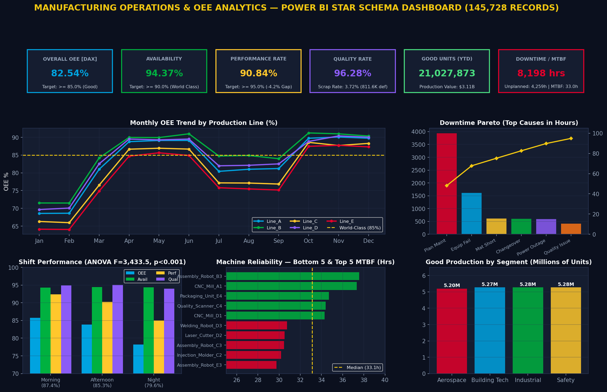

# Manufacturing Operations & OEE Analytics Dashboard

 *(Preview)*

## 🏭 Overview
The **Manufacturing Operations & OEE Analytics Dashboard** is an end-to-end data engineering and business intelligence solution designed to track, analyze, and optimize factory floor productivity. 

By ingesting raw machine logs and transforming them into a structured **Star Schema**, this project enables plant managers to monitor **Overall Equipment Effectiveness (OEE)** in real-time, identify root causes of machine downtime, and track product quality across multiple production lines and shifts.

---

## 🏗️ Architecture & Data Pipeline

This project is built in two primary stages:

### 1. Data Engineering (Python ETL)
The backend is powered by a Python script (`scripts/etl_pipeline.py`) that uses **Pandas** to process raw manufacturing data.
- **Extract:** Reads hourly production logs (`data/raw/manufacturing_data.csv`).
- **Transform:** 
  - Cleans data (removes duplicates, clips negative values, handles NaNs).
  - Enforces data integrity constraints (`good_units + defect_units = total_units`).
  - Computes row-level OEE metrics (Availability, Performance, Quality, Scrap Rate).
- **Load:** Outputs clean, normalized CSV files structured into a **Star Schema** (`data/processed/`).

### 2. Business Intelligence (Power BI)
The processed Star Schema is imported into Power BI, where a dedicated **Measures Table** uses advanced **DAX formulas** to calculate:
- Dynamic OEE aggregation across filter contexts.
- Time Intelligence metrics (Month-over-Month changes, YTD).
- Machine Reliability metrics (MTBF - Mean Time Between Failures).
- Pareto analysis for downtime root causes.

---

## 🗄️ Data Model (Star Schema)

The database follows a Kimball-style Star Schema, optimized for fast aggregations and dynamic filtering in Power BI.

**Fact Table:**
- `fact_production`: Contains measurable events (run time, downtime, units produced, energy consumed) and pre-calculated OEE components.

**Dimension Tables:**
- `dim_date`: Calendar hierarchy and fiscal periods.
- `dim_machine`: Machine metadata (OEM, install year, maintenance intervals).
- `dim_product`: Product catalog, ideal cycle times, and unit costs.
- `dim_shift`: Shift schedules (Morning, Afternoon, Night).
- `dim_operator`: Employee details, experience levels, and certifications.

---

## 📊 Key Features & Visualizations

- **OEE KPI Cards:** Real-time visibility into Availability, Performance, and Quality with conditional formatting (Green: ≥85%, Yellow: ≥75%, Red: <75%).
- **Downtime Pareto Chart:** Quickly identifies the 20% of downtime reasons causing 80% of lost production time (e.g., Equipment Failure vs. Material Shortage).
- **Machine Reliability (MTBF):** Tracks the Mean Time Between Failures for individual machines to guide preventative maintenance schedules.
- **Shift Performance ANOVA:** Compares OEE across day and night shifts to identify workforce training needs.
- **Energy Efficiency Tracking:** Correlates energy consumption (kWh) against production output to track sustainability goals.

---

## 🚀 How to Run the Project

### Prerequisites
- Python 3.8+
- Pandas, NumPy
- Power BI Desktop

### 1. Run the ETL Pipeline
Navigate to the project root and execute the data generation and ETL scripts:
```bash
# Generate simulated raw data (if needed)
python scripts/generate_data.py

# Run the ETL pipeline to build the Star Schema
python scripts/etl_pipeline.py
```
This will populate the `data/processed/` directory with the required CSV files.

### 2. View the Dashboard
- **Live HTML Preview:** Open `dashboard/dashboard_preview.html` in any modern web browser to view an interactive frontend mockup of the dashboard design.
- **Power BI Interactive Dashboard:** Open the `.pbix` file in Power BI Desktop to explore the live DAX measures and interact with the data filters.

---

## 📈 DAX Highlights
A sample of the DAX logic used in this project to calculate Month-over-Month OEE changes safely:
```dax
OEE MoM Change = 
VAR _Current = [OEE]
VAR _Previous = CALCULATE([OEE], DATEADD(dim_date[date], -1, MONTH))
RETURN
    IF(NOT(ISBLANK(_Previous)), _Current - _Previous, BLANK())
```

---

## 🛠️ Tech Stack
- **Languages:** Python (Data Engineering), DAX (Analytics)
- **Libraries:** Pandas, NumPy
- **BI Tool:** Power BI Desktop
- **Frontend (Preview):** HTML5, CSS3, Chart.js

---
*Created by Kabir Roy*
