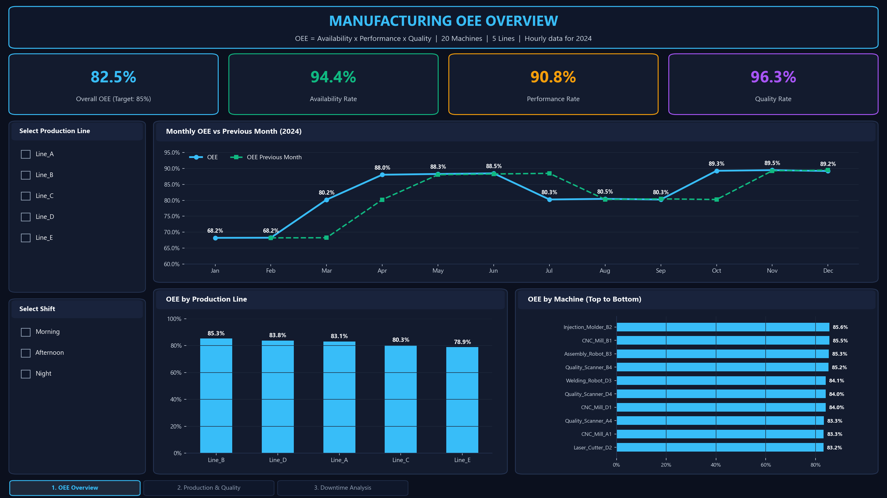
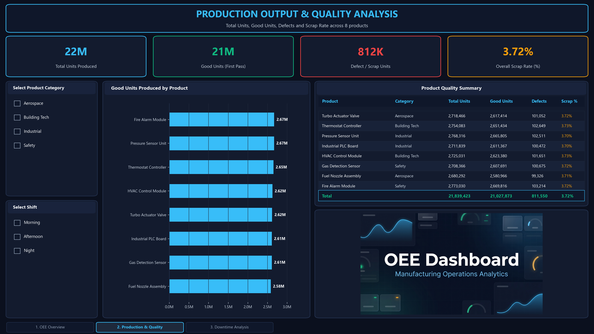
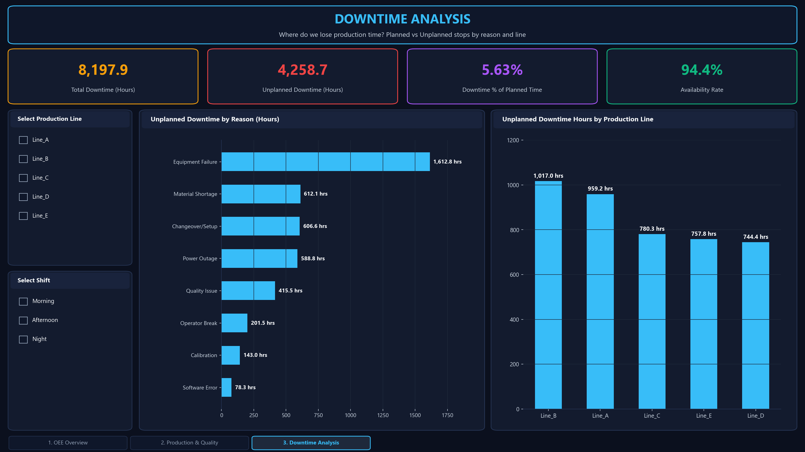
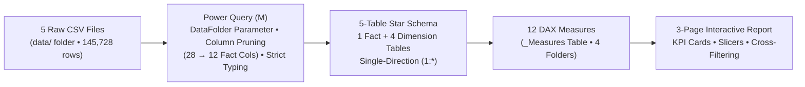
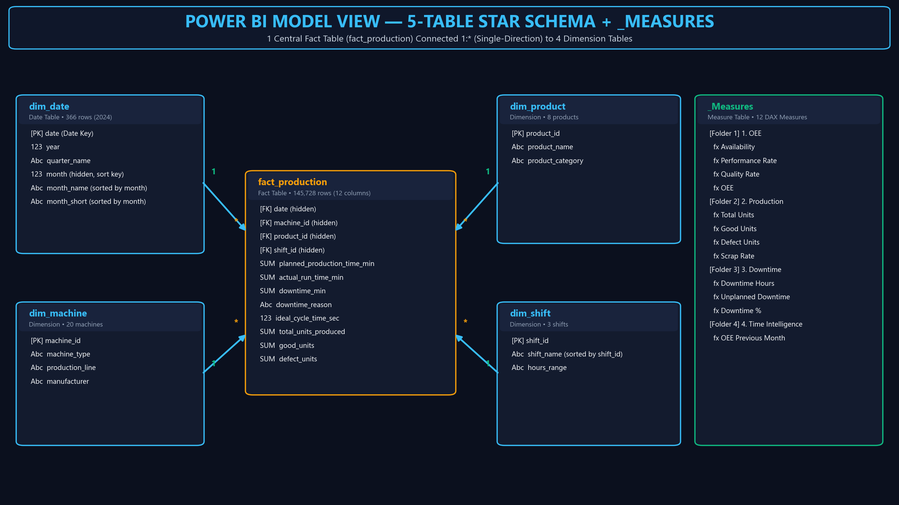
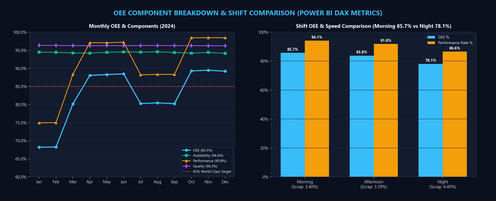

# Manufacturing Operations & OEE Analytics Dashboard (Power BI)

-F2C811?style=for-the-badge&logo=powerbi&logoColor=black)


An end-to-end **Power BI Manufacturing Operations & OEE (Overall Equipment Effectiveness) Dashboard** analyzing **145,728 hourly machine production logs** across **20 machines**, **5 production lines**, **8 products**, and **3 shifts** for full-year **2024**.

$$\text{OEE} = \text{Availability} \times \text{Performance} \times \text{Quality}$$

---

## 1. Dashboard Preview (3 Interactive Report Pages)

### Page 1 — `1. OEE Overview`
Tracks headline **OEE (`82.5%`)** against the **`85.0%` World-Class benchmark**, breaking efficiency into **Availability (`94.4%`)**, **Performance (`90.8%`)**, and **Quality (`96.3%`)**, alongside monthly trend lines (`OEE` vs. `OEE Previous Month`), production line rankings, and machine rankings.



---

### Page 2 — `2. Production & Quality`
Monitors total manufacturing volume (**`21.84M` Total Units**, **`21.03M` Good Units**, **`811.55K` Defect Units**, **`3.72%` Scrap Rate**) with interactive product-level output bars and a **Product Quality Summary** table across all 8 products and 4 product categories (`Aerospace`, `Building Tech`, `Industrial`, `Safety`).



---

### Page 3 — `3. Downtime Analysis`
Separates scheduled maintenance from **Unplanned Downtime (`4,258.7 Hours`)** out of **`8,197.9` Total Downtime Hours (`5.63%` of Planned Time)**, ranking unplanned stops by root cause (`Equipment Failure`, `Material Shortage`, `Changeover/Setup`, `Power Outage`, `Quality Issue`, `Operator Break`, `Calibration`, `Software Error`) and by production line.



---

## 2. Project Architecture & Data Pipeline



### What's Inside the Repository

| File / Folder | Description |
| :--- | :--- |
| **`OEE_Dashboard_Simple.pbip`** | **Main Power BI Project file.** Double-click to open directly in Power BI Desktop, then click **Home → Refresh**. |
| **`OEE_Dashboard_Simple.Report/`** | PBIR report definition containing the 3 pages, visual layouts, and custom dark theme (`HoneywellIndustrialDark.json`). |
| **`OEE_Dashboard_Simple.SemanticModel/`** | TMDL semantic model definition (`tables/`, `relationships.tmdl`, `expressions.tmdl`, `diagramLayout.json`). |
| **`data/`** | The 5 Star Schema CSV tables (`fact_production.csv`, `dim_date.csv`, `dim_machine.csv`, `dim_product.csv`, `dim_shift.csv`). |
| **`DAX_Measures.dax`** | All **12 DAX measures** with plain-English comments grouped into 4 display folders. |
| **`INTERVIEW_GUIDE.md`** | Complete walkthrough of the data model, Power Query steps, DAX formulas, insights, and interview Q&A. |
| **`dashboard/screenshots/`** | High-resolution screenshots of all 3 report pages, the Star Schema model view, and supporting trend charts. |

---

## 3. Data Model — 5-Table Kimball Star Schema

The semantic model follows a clean **Kimball Star Schema** with **1 central Fact table** (`fact_production`) connected via **single-direction (`1:*`) relationships** to **4 Dimension tables** (`dim_date`, `dim_machine`, `dim_product`, `dim_shift`), plus a dedicated **`_Measures`** table.



| Table | Role | Rows | Grain & Key Columns Kept in Power Query |
| :--- | :--- | :--- | :--- |
| **`fact_production`** | **Fact Table** | `145,728` | One row per machine per hour (`12` columns kept from `28` raw columns: `date`, `machine_id`, `product_id`, `shift_id`, `planned_production_time_min`, `actual_run_time_min`, `downtime_min`, `downtime_reason`, `ideal_cycle_time_sec`, `total_units_produced`, `good_units`, `defect_units`). Foreign keys are hidden in Report View. |
| **`dim_date`** | **Date Dimension** | `366` | Calendar dates for leap-year 2024 (`date` [PK], `year`, `quarter_name`, `month` [hidden sort key], `month_name`, `month_short`). Marked as Date Table; `month_name` and `month_short` are sorted chronologically by `month` (`1–12`). |
| **`dim_machine`** | **Machine Dimension** | `20` | 20 shop-floor machines across 5 lines (`machine_id` [PK], `machine_type`, `production_line`, `manufacturer`). |
| **`dim_product`** | **Product Dimension** | `8` | 8 manufactured products across 4 categories (`product_id` [PK], `product_name`, `product_category`). |
| **`dim_shift`** | **Shift Dimension** | `3` | 3 daily 8-hour shifts (`shift_id` [PK], `shift_name` sorted by `shift_id`, `hours_range`: Morning `06:00–14:00`, Afternoon `14:00–22:00`, Night `22:00–06:00`). |
| **`_Measures`** | **Measure Table** | `1` | Dedicated container holding all **12 explicit DAX measures** organized into **4 Display Folders**. |

---

## 4. Power Query (M) Transformations

Opening **Home → Transform data** in Power BI Desktop shows 4 clean, reproducible steps on each table:
1. **`DataFolder` Parameter**: A centralized text parameter pointing to the `data\` folder so all 5 CSV queries update from a single path if the folder moves.
2. **`Promoted Headers`**: Promotes the first CSV row to column names.
3. **`Removed Other Columns` (`Table.SelectColumns`)**: Prunes unused raw columns (`fact_production` is slimmed from 28 raw columns down to the 12 columns required for reporting), reducing memory footprint and keeping the field pane clean.
4. **`Changed Type` (`Table.TransformColumnTypes`)**: Explicitly enforces `date`, `Int64.Type` (whole numbers), `type number` (decimals), and `type text`.

---

## 5. All 12 DAX Measures (`_Measures` Table)

All KPIs are written as explicit **DAX measures** (using ratio-of-totals rather than averaging row-level percentages) and grouped into 4 display folders:

### Folder 1: `1. OEE`
```dax
// Share of planned production time that the machine was actually running
Availability =
DIVIDE(
    SUM(fact_production[actual_run_time_min]),
    SUM(fact_production[planned_production_time_min])
)

// Ideal time required for total units produced divided by actual run time (in seconds)
Performance Rate =
DIVIDE(
    SUMX(fact_production, fact_production[ideal_cycle_time_sec] * fact_production[total_units_produced]),
    SUM(fact_production[actual_run_time_min]) * 60
)

// First-pass yield: good units divided by total units produced
Quality Rate = DIVIDE([Good Units], [Total Units])

// Headline KPI (World-Class Target >= 85.0%)
OEE = [Availability] * [Performance Rate] * [Quality Rate]
```

### Folder 2: `2. Production`
```dax
Total Units  = SUM(fact_production[total_units_produced])
Good Units   = SUM(fact_production[good_units])
Defect Units = SUM(fact_production[defect_units])
Scrap Rate   = DIVIDE([Defect Units], [Total Units])
```

### Folder 3: `3. Downtime`
```dax
// Convert downtime minutes to hours
Downtime Hours = DIVIDE(SUM(fact_production[downtime_min]), 60)

// Unplanned stops only (excludes scheduled Planned Maintenance and No Downtime)
// KEEPFILTERS preserves the visual's row filter on the Downtime by Reason bar chart
Unplanned Downtime =
CALCULATE(
    [Downtime Hours],
    KEEPFILTERS(NOT(fact_production[downtime_reason] IN {"Planned Maintenance", "No Downtime"}))
)

// Share of planned production time lost to downtime
Downtime % =
DIVIDE(
    SUM(fact_production[downtime_min]),
    SUM(fact_production[planned_production_time_min])
)
```

### Folder 4: `4. Time Intelligence`
```dax
// Shifts the date filter back 1 month on the Monthly OEE Trend line chart
OEE Previous Month = CALCULATE([OEE], DATEADD(dim_date[date], -1, MONTH))
```

---

## 6. Key Findings & Business Recommendations



| Area | Exact Power BI Finding | Business Takeaway |
| :--- | :--- | :--- |
| **Overall Plant OEE** | **`82.5%` OEE** (`94.4%` Availability × `90.8%` Performance × `96.3%` Quality) | The plant is **`2.5` percentage points** shy of the `85.0%` World-Class target. **Performance (`90.8%`, speed loss)** is the #1 drag on OEE, not machine availability. |
| **Production Line Comparison** | **`Line_B` leads at `85.3%`** (`World-Class`), followed by `Line_D` (`83.8%`), `Line_A` (`83.1%`), `Line_C` (`80.3%`), and **`Line_E` last at `78.9%`** | Prioritize cycle-time tuning on **`Line_E` (`86.8%` Performance)** and **`Line_C` (`88.4%` Performance)** using `Line_B` as the internal benchmark. |
| **Shift Disparity** | **Morning: `85.7%` OEE** (`3.40%` scrap) · **Afternoon: `83.8%` OEE** (`3.42%` scrap) · **Night: `78.1%` OEE** (`4.44%` scrap) | The **Night Shift** trails Morning by **`7.6` OEE points** due to slower running speed (`86.6%` Performance) and higher scrap (`4.44%`). Add night-shift technical supervision and standardized shift-handover checklists. |
| **Unplanned Downtime Causes** | **`4,258.7 hrs` Unplanned** (out of `8,197.9 hrs` total):<br>1. **Equipment Failure:** `1,612.8 hrs` (`37.9%`)<br>2. **Material Shortage:** `612.1 hrs` (`14.4%`)<br>3. **Changeover/Setup:** `606.6 hrs` (`14.2%`)<br>4. **Power Outage:** `588.8 hrs` (`13.8%`) | The top 3 unplanned causes account for **`66.5%`** of all unplanned stops (`80.3%` with Power Outage). Preventive maintenance on top breakdown machines and buffer stock replenishment target the biggest losses directly. |
| **Product Quality** | **`21,839,423` Total Units** · **`21,027,873` Good Units** · **`811,550` Defects (`3.72%` Scrap)** | Scrap rate is uniform across all 8 products (`3.70%–3.73%`), proving defects are driven by **shift and line operating conditions** rather than a single product design. |

---

## 7. How to Open in Power BI Desktop

1. Clone or download this repository.
2. Double-click **[`OEE_Dashboard_Simple.pbip`](OEE_Dashboard_Simple.pbip)** to open the project in **Microsoft Power BI Desktop**.
3. Click **Home → Refresh** to load the 5 CSV files from `data/`.
4. *If you moved the folder to a different path on your PC:* go to **Home → Transform data → Edit parameters → `DataFolder`**, paste the full path to your local `data\` folder (ending with `\`), click **OK**, and click **Apply changes / Refresh**.
